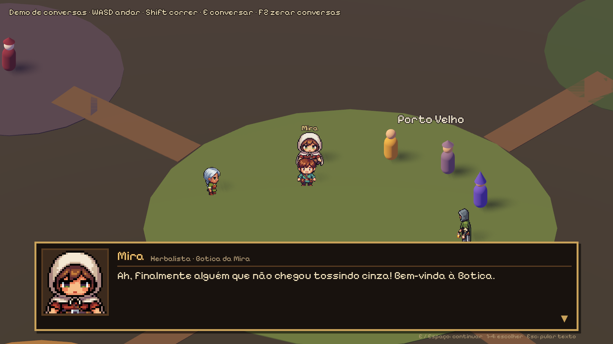
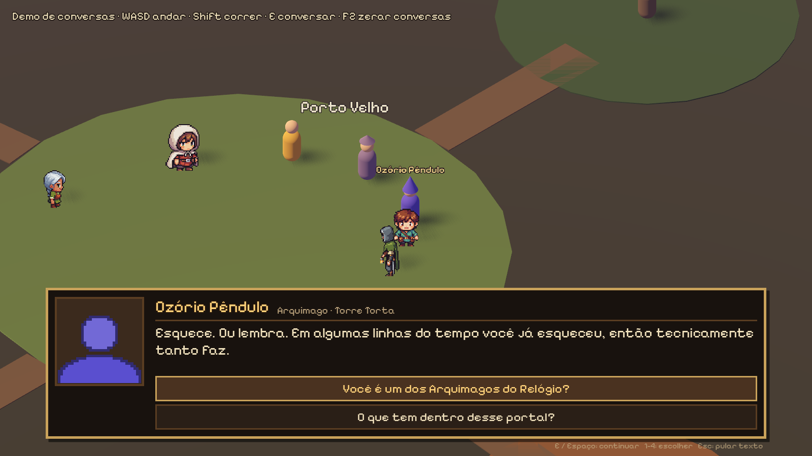
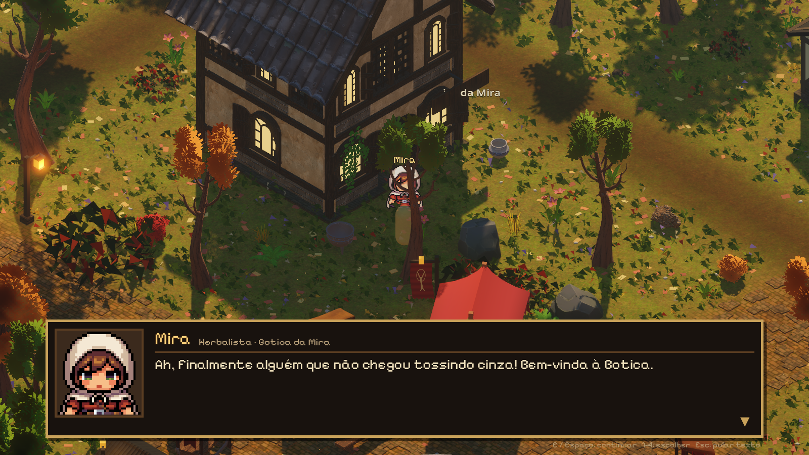

# Conversas com os moradores — Ilha das Cinzas

Sistema de diálogo com caixa de texto em pixel art, retrato, efeito de máquina de escrever, escolhas
e as primeiras conversas de 12 moradores. Feito sem mexer em `main.tscn`, `reference_village`, save,
arquivos da Vale, do equipamento ou do combate.




## Addon escolhido: Dialogue Manager 4.1.0 (Nathan Hoad, MIT)

- Versão 4.1.0 de 04/09/2026, mantida ativamente e compatível com Godot 4.7.2 (testado aqui).
- Escrita em texto simples (`.dialogue`), parecida com roteiro: fácil de editar e de revisar no Git.
- Tem editor próprio (aba **Dialogue** no Godot), condições, variáveis, escolhas, aleatoriedade e traduções.
- Deixa a aparência 100% nossa: a caixa é uma cena do projeto (`scenes/ui/caixa_dialogo.tscn`).
- Alternativa considerada: Dialogic 2 ainda está em alfa (2.0-alpha-20) e é bem mais pesado.

### O único gancho em arquivo existente: `project.godot`

O addon precisa estar ligado como plugin e como autoload. Foram acrescentadas **duas linhas**
(backup em `work/backups/dialogos/project.godot.antes_dialogos`):

```
[autoload]
DialogueManager="*res://addons/dialogue_manager/dialogue_manager.gd"

[editor_plugins]
enabled=PackedStringArray(..., "res://addons/dialogue_manager/plugin.cfg")
```

Se preferir ligar à mão: **Projeto > Configurações do Projeto > Plugins > Dialogue Manager > Ativar**
(isso cria as mesmas duas linhas). Se o Claude Code também mexeu em `project.godot`, faça isso em vez de
copiar o arquivo do zip.

## Testar

1. Descompacte o pacote na raiz do projeto (`ilha_entrega_completa.zip`, ou as partes `ilha_entrega_*.zip` uma por uma).
2. Abra o projeto no Godot uma vez (ele importa os `.dialogue`).
3. Abra `scenes/dialogos/demo_dialogos.tscn` e aperte **F6**.
   - WASD anda, Shift corre, **E** conversa, **F2** zera as conversas.
   - Na caixa: **E / Espaço / Enter / clique** continua, **1–4** ou setas escolhem, **Esc** pula o texto.
4. Testes automáticos (percorre todos os ramos de todas as conversas e a demo por teclado):
   `godot --headless --path . -s res://tests/dialogos_testes.gd` → `PASS: 126 verificacoes, 0 falhas`.

## Colocar um morador num mapa

**Jeito 1, por marcador (recomendado):** no mapa, crie um `Marker3D` com o nome do id
(`mira`, `NPC_mira` ou `npc_mira`) onde o morador deve ficar. No script do mapa:

```gdscript
const Interacao = preload("res://scripts/dialogos/interacao_npcs.gd")
var dialogos

func _ready() -> void:
	dialogos = Interacao.new()
	dialogos.jogador = player   # CharacterBody3D da Vale
	dialogos.game = self        # opcional: trava a Vale via demo_mode, igual interiores.gd
	add_child(dialogos)
	Interacao.spawn_em_marcadores(self)   # cria um morador em cada Marker3D com nome de id
```

**Jeito 2, por código:** `Interacao.criar_npc("ferreiro", ground, Transform3D(Basis(), Vector3(4, 0, 2)))`

**Jeito 3, na cena:** adicione um `Node3D` com o script `scripts/dialogos/npc_conversavel.gd` e
preencha `npc_id` no Inspetor.

### Mapas que já usam a tecla E (vila, fazenda)

Esses mapas usam E para portas (`scripts/modular/interiores.gd`) e para a caixa de envio. Para não
brigar, desligue o E automático e encadeie igual às portas, **antes** das outras ações de E:

```gdscript
dialogos.tratar_tecla_e = false
# em _unhandled_key_input:
if k == KEY_E and dialogos and dialogos.tecla_e():
	return
```

Esse encaixe na vila e na fazenda **não foi feito**, porque esses arquivos estão com o Claude Code.

## Escrever ou editar conversas

Um arquivo por morador em `dialogos/<id>.dialogue`. Cada um tem dois blocos:
`~ start` (primeira conversa) e `~ de_novo` (falas curtas quando você volta).

```
~ start
if tem("ferreiro_conheceu")
	=> de_novo
Gaspar Bigorna: Afasta da forja!
- Você faz ferramentas melhores?
	Gaspar Bigorna: Faço tudo melhor.
	$> confiar("ferreiro", 1)
- Sabe trabalhar adamantium?
	Gaspar Bigorna: Falar desse metal dá azar.
$> marcar("ferreiro_conheceu")
=> END
```

- `Nome: fala`: o nome tem que ser igual ao `nome` do registro (`scripts/dialogos/npcs_registro.gd`),
  ou `Vale`, para aparecer o retrato certo.
- `- texto` é uma escolha. As falas recuadas com TAB embaixo dela são a resposta.
- `% fala`: escolhe uma das linhas ao acaso.
- Funções do estado (`scripts/dialogos/estado_dialogos.gd`): `tem(x)`, `marcar(x)`, `confiar(id, n)`,
  `comer(prato)` (bônus da Estalagem), `pedir_missao(x)` (mural da Guarda). O estado fica na memória.
  `salvar()` e `carregar()` usam um arquivo novo, `user://dialogos_estado_v1.json`, e não tocam no save da fazenda.
- Novo morador: crie `dialogos/<id>.dialogue`, acrescente uma linha em `NPCS` no registro e rode os testes.

## Moradores e primeiras conversas

Os nomes marcados com * são **sugestões minhas**. Troque à vontade no registro e nos `.dialogue`.

| id | Nome | Onde | Arte | Primeira conversa |
|---|---|---|---|---|
| mira | Mira | Botica da Mira, Porto Velho | sprite existente | Recebe a Vale entre frascos e explica que a cinza é "tempo moído" que fortalece as ervas. Escolha: a ciência da cinza ou um chá grátis pras costas. |
| jardineira | Dona Iolanda* | Celeiro das Sementes | sprite existente | Avalia a novata, dá sementes de nabo-cinzento e avisa que nabo é vaidoso: elogie, e nunca fale da sopa. |
| guardia | Brida Ferrolho* | Posto da Guarda | sprite do guardião (provisório) | Interroga a forasteira. Escolha: aceitar o pedido "ratos de cinza no cais" do mural ou provocar, e ela tenta, sem jeito, contar uma piada. |
| sineiro | Mestre Anselmo* | Torre do Sino | boneco provisório | O sino ainda treme de uma badalada de 32 anos atrás. Conta a Queda (o Coração do Tempo "rachou como ovo") ou proíbe com carinho que você toque o sino. |
| ferreiro | Gaspar Bigorna* | Ferraria do Porto | boneco provisório | Oferece ferramentas melhores ou, sério, revela que o avô forjava adamantium para os Arquimagos, um metal que "sussurrava horários". |
| estalajadeira | Dona Rosalva* | Estalagem da Lanterna | boneco provisório | A lanterna que nunca apagou. Prato de boas-vindas à escolha: Ensopado de Brasa (força), Torta de Nabo-Cinzento (fôlego) ou Chá da Lanterna. Ativa `comer()`. |
| arquimago | Ozório Pêndulo* | Torre Torta | boneco provisório | A Vale pisa no círculo e existe em 4 lugares, um deles numa panela. Confessa que quebrou o Coração ("um acidente bem planejado") ou mostra o portal da ilha governada por galinhas eleitas. |
| capitao | Capitão Bartolomeu Nuvem* | Doca de dirigíveis | boneco provisório | Último dirigível da rota. Explica por que ninguém vem mais (medo, pedágio de dragão) ou pede 10 caixas de colheita para abrir uma rota nova. |
| lider_orc | Grusha Dente-de-Ferro* | Vila dos Orcs | boneco provisório | "Por que não te jogar do penhasco?" Honra (mais confiança) ou comércio, e ela revela que os orcs vieram de uma linha do tempo onde venceram a guerra. "Confia em cicatriz." |
| condessa | Condessa Ofélia de Cinzalta* | Mercado Noturno, Cidade Fantasma | boneco provisório | Vende relíquias (o bule com chá de ontem) e fragmentos do Coração, ou lembra da valsa que parou junto com o tempo. Aceita pagamento em anos de vida. |
| lobisomem | Tobias do Ermo* | Ilha Selvagem | boneco provisório | Amaldiçoado pela cinza, vira bicho quando o tempo racha. Leva um pelo pra Mira estudar a cura, ou ganha confiança com um "não tenho medo". |
| dragao | Ambarion* | Rota do Âmbar | boneco provisório | Há mil anos cobra pedágio, hoje aceita queijo. Pergunte o preço (uma história nova) ou recuse ("é contabilidade"). Tem uma versão vegetariana em outra linha do tempo. |

O humor de multiverso só usa o tom (portais absurdos, versões alternativas, burocracia cósmica).
Nenhum nome, personagem ou referência de outra obra.

## Conversar nos mapas grandes (Porto Velho, Vila dos Orcs, Cidade Fantasma)

Os três mapas de `README_VILA_GRANDE.md` já vêm com as conversas ligadas. Não precisa mexer em nada:

| Mapa | Abrir (F6) | Moradores |
|---|---|---|
| Porto Velho | `scenes/vila_grande/vila_grande.tscn` | Mira, Dona Iolanda, Brida, Mestre Anselmo, Gaspar, Dona Rosalva, Ozório, Capitão Nuvem, Ambarion (na entrada da doca) + 5 de fundo |
| Vila dos Orcs | `scenes/vila_orcs/vila_orcs.tscn` | Grusha + 7 de fundo |
| Cidade Fantasma | `scenes/cidade_fantasma/cidade_fantasma.tscn` | Condessa Ofélia, Tobias + 6 de fundo |

Ande até o morador com **WASD**, espere aparecer **"E - Conversar"** e aperte **E**. A jogadora fica parada
enquanto a caixa está aberta. Cada cena tem um nó `Dialogos` (`interacao_npcs.gd`), e o `mapa_cc0.gd` chama
`spawn_em_marcadores()` nos `Marker3D` de `Marcadores`.



### Moradores de fundo (1–2 falas cada)

Todo marcador extra dos mapas conversa. Eles ficam em `GENERICOS` no registro (fora de `ids()`, que continua
com os 12 moradores com história) e usam boneco provisório. Nomes são sugestões minhas.

| id | Nome | Mapa |
|---|---|---|
| mercador_praca | Mercador da Praça | Porto Velho |
| morador_1 | Seu Lauro | Porto Velho |
| morador_2 | Dona Cecília | Porto Velho |
| crianca_praca | Pipo | Porto Velho |
| gato | Gato da Praça | Porto Velho |
| xama_orc | Xamã Urzaga | Vila dos Orcs |
| ferreiro_orc | Krag Martelo-Torto | Vila dos Orcs |
| guerreiro_orc_1 | Guerreiro Orc | Vila dos Orcs |
| guerreiro_orc_2 | Sentinela Orc | Vila dos Orcs |
| cacadora_orc | Caçadora Orc | Vila dos Orcs |
| anciao_orc | Ancião Borgo | Vila dos Orcs |
| prisioneiro | Prisioneiro | Vila dos Orcs |
| espectro_sineiro | Espectro do Sineiro | Cidade Fantasma |
| eco_arquimago | Eco de Ozório | Cidade Fantasma |
| mercador_reliquias | Mercador de Relíquias | Cidade Fantasma |
| coveiro | Coveiro Ermelindo | Cidade Fantasma |
| vampiro_menor_1 | Vampiro Menor | Cidade Fantasma |
| espectro_1 | Espectro Queimado | Cidade Fantasma |

`vampiro_menor_1` e `espectro_1` eram marcadores de inimigo: por enquanto só falam (uma ameaça), sem combate.

### Testes dos mapas

`godot --headless --path . -s res://tests/mapas_dialogos_testes.gd` → `PASS: 314 verificacoes, 0 falhas`.
Carrega os 3 mapas, confere um morador por marcador, roda a primeira conversa de cada um dos 30 até o fim,
e em Porto Velho testa o E perto da Mira e que a jogadora não anda durante a conversa.

## Arquivos

Novos:
- `addons/dialogue_manager/`: addon Dialogue Manager 4.1.0 (MIT, com `LICENSE`)
- `art/ui/dialogos/fontes/PixelifySans.ttf` + `OFL.txt`, e `art/ui/dialogos/CREDITOS_DIALOGOS.md`
- `dialogos/*.dialogue`: as 12 conversas + 18 falas de moradores de fundo
- `scenes/ui/caixa_dialogo.tscn`, `scripts/dialogos/caixa_dialogo.gd`: caixa de diálogo
- `scripts/dialogos/npcs_registro.gd`: ids, nomes, títulos, arte, retratos e fonte
- `scripts/dialogos/estado_dialogos.gd`: marcas, confiança, refeição e missões
- `scripts/dialogos/npc_conversavel.gd`: componente do morador (visual, Area3D, "E - Conversar")
- `scripts/dialogos/interacao_npcs.gd`: gerente da cena + `spawn_em_marcadores()`
- `scenes/dialogos/demo_dialogos.tscn`, `scripts/dialogos/demo_dialogos.gd`: cena de teste
- `tests/dialogos_testes.gd` (testes headless) e `tests/dialogos_captura.gd` (captura de tela)
- `docs/dialogos-caixa-mira.png`, `docs/dialogos-caixa-escolhas.png`, `docs/dialogos-testes.log`
- `README_DIALOGOS.md`

- `tests/mapas_dialogos_testes.gd` (testes dos 3 mapas) e `tests/mapas_dialogos_capturas.gd` (capturas com a caixa aberta)
- `docs/integracao-*.png`: um print por mapa com a caixa aberta

Alterado: `project.godot`, só **2 linhas** (1 linha nova em `[autoload]` e o plugin acrescentado em `enabled=`
de `[editor_plugins]`). O resto do arquivo fica igual ao commit 96314ad. Se o Godot reescrever o arquivo ao abrir
o editor (ele reorganiza as seções), tudo bem: o conteúdo é o mesmo.
