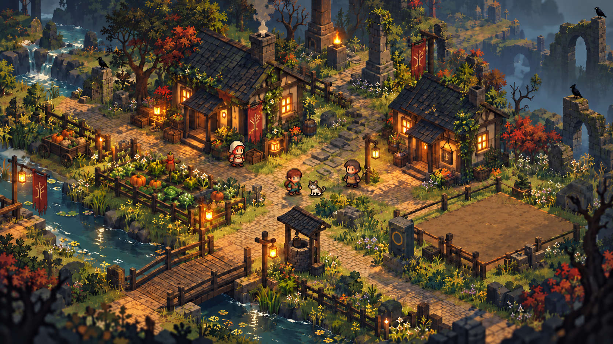

# Aproximação do layout alvo — V4

Referências recebidas em 18/10/2026: personagem no vídeo Emberfall/Luminati e composição da vila enviada pelo usuário. As imagens orientam proporção, ocupação e iluminação; os personagens produzidos para o projeto são originais.

## Leitura do alvo

A praça é o espaço de respiro central. Duas casas enquadram o fundo, a escada leva às ruínas e o canal atravessa o primeiro plano. A horta fica à esquerda, perto de água e casa; o lote de construção ocupa a direita. Vegetação densa contorna as áreas, enquanto caminhos, portas, ponte e células de cultivo permanecem legíveis.

O personagem da referência tem aproximadamente 2 a 2,5 cabeças de altura, cabelo visível, corpo compacto e poucos detalhes. O protagonista anterior tinha proporções de aventureiro mais alto. A V4 inicia a troca por um aprendiz com cabelo castanho e túnica verde, com animações próprias.

## Primeira etapa jogável desta rodada

| Área | Mudança | Critério de validação |
|---|---|---|
| Personagens | Proporções compactas e desenhos autorais | Cabeça e direção legíveis na distância normal da câmera |
| Árvores | Folhas com recorte de alfa, luz nas duas faces, transmissão e vento | Luz dourada atravessa a copa; sombras das folhas aparecem na superfície |
| Pôr do sol | L inicia transição contínua da tarde até a noite | Sol e sombras se movem; folhas perdem o dourado; lua e lanternas assumem a luz |
| Horta | Nove quadrados separados, seleção visível e rega individual | E planta/colhe; R molha; só mudas regadas crescem no próximo dia |
| Árvore cortável | Tronco com colisão, três golpes, queda, toco e madeira | F corta perto do tronco; E recolhe; save impede madeira duplicada |
| Companhia | Uma única jardineira, conversa separada de acompanhamento | E conversa; C pede companhia; parada não produz caminhada sem sair do lugar |
| Construção | Remover a armação opaca e abrir um lote acessível | Praça e espaço futuro ficam claramente separados |

## Dimensões para jogar

Os quadrados de terra têm 1,05 m de lado; os centros se separam em 1,70 m no eixo horizontal e 1,75 m no outro eixo. Isso deixa corredores de 0,65 m e 0,70 m entre quadrados; o personagem usa cápsula de 0,50 m de diâmetro. A seleção alcança o canteiro mais próximo a até 1,35 m. É possível regar pelas bordas sem entrar no volume da planta.

A ponte mantém travessia de aproximadamente 2,2 m. O lote de construção tem aproximadamente 5,2 × 4,1 m, com abertura de 1,3 m na cerca. Essas medidas devem ser revistas depois do teste manual de movimento.

## Próximas etapas para chegar à imagem

1. **Composição e escala:** validar o novo personagem, distância da câmera e posição da horta. Ajustar a praça e as duas casas com base no teste; manter a ponte como entrada visual.
2. **Margens orgânicas:** substituir o canal reto por curvas, pedras, pequenas ilhas de capim e duas quedas de altura. Preservar o caminho principal e evitar que vegetação esconda áreas interativas.
3. **Arquitetura:** telhas com escala de detalhe consistente, beirais, jardineiras, caixas, trepadeiras e faixas de tecido. Transformar os conjuntos em módulos reutilizáveis para construção dinâmica.
4. **Ruínas e relevo:** escada central mais larga e contínua, patamares claramente delimitados, arcos quebrados e planos distantes com contraste menor. O terreno do núcleo da vila precisa de composição controlada; a geração procedural deve respeitar esses limites.
5. **Vegetação por função:** copas maiores no fundo, arbustos nas bordas, flores junto dos caminhos e exclusões em frente das portas. Reservar árvores de recurso separadas de árvores cenográficas.
6. **Acabamento:** revisar a consistência dos ciclos de animação, poses de ferramentas, oclusão da copa e edifícios, navegação completa dos acompanhantes e níveis de qualidade.

## Limites desta etapa

O lote está reservado visualmente, mas a colocação de edifícios ainda não foi implementada. O acompanhamento por trilha melhora a parada e o percurso; não substitui uma malha de navegação para todos os obstáculos dinâmicos. O ciclo solar pode ser acelerado com L para avaliação e não é ainda o calendário completo do jogo. A rega usa uma regra simples de um amanhecer, sem inventário de ferramentas ou reservatório de água.

