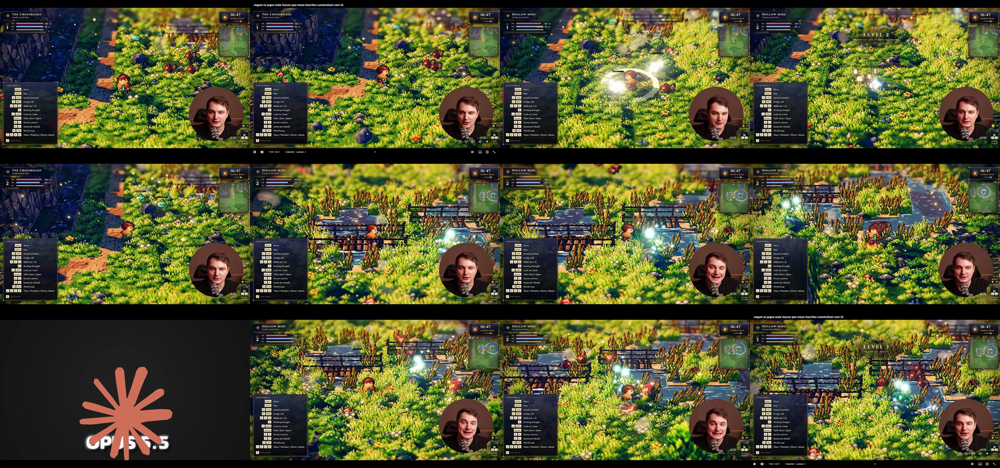

# Ilha das Cinzas — análise, direção e roadmap

18 de outubro de 2026 • Proposta inicial para revisão • Nome provisório

## Recomendação

Usar **Godot 4.7.2**, já instalado e empregado no Chrono Memories local. Construir um projeto independente com cenário 3D, câmera elevada e personagens em sprites 2D. Começar pelo ciclo de retorno ao lar e pela sensação de movimento; decidir a forma final do combate híbrido após uma comparação jogável.

A promessa é: **“Cultivar um lugar que vale a pena defender, com pessoas que passam a defender esse lugar com você.”** A fazenda fornece provisões e reconstrução; relações abrem assistência; expedições recuperam sementes e materiais. Esses sistemas precisam se cruzar para o jogo não virar três jogos concorrendo pelo tempo do jogador.

## Vídeo: o que foi observado

Arquivo original recuperado do anexo da conversa: 47,96 segundos, H.264, 2304×1440 e cerca de 29,58 quadros/s. É gravação de uma reprodução do YouTube com apresentador e cortes; não é captura limpa do jogo. Foram examinados o conjunto do clipe por amostragem a cada quatro segundos, a sequência entre 7 e 10 segundos a quatro amostras/s e um quadro detalhado aos 22 segundos. Esse método informa leitura visual e deslocamento, mas não mede latência de entrada ou frame data.

| Trecho aproximado do arquivo | Evidência | Implicação para o projeto |
|---|---|---|
| 0–6 s | Caminho terroso, rochas, herói pequeno com contorno escuro, vegetação densa e sol quente | O herói precisa de contraste local e solo visualmente limpo nas rotas |
| 7–10 s | Mudança de direção do sprite, movimento pelo chão, flashes e arcos de ataque próximos | Locomoção livre e combate no ambiente; testar oito direções com animações curtas |
| 12–28 s | Pontes, água, sobreposição de cercas/personagem, partículas ciano | Profundidade e oclusão precisam funcionar de verdade; atravessar uma ponte é uma prova visual útil |
| Cerca de 32 s | Corte para tela com logotipo | Não confundir edição do vídeo com transição do jogo |
| 36–47 s | Retorno à área de pontes, combate e aviso de nível | A referência prioriza resposta visual abundante; moderar efeitos para preservar leitura |

O quadro detalhado lista WASD, corrida com Shift, ataque/combo com J ou clique esquerdo, esquiva com K ou clique direito, habilidades, lock-on, interação, rotação e zoom. A legenda comprova comandos anunciados, não a qualidade de implementação de todos eles.

**Observação:** a câmera alta, sombras, volumes e oclusões sugerem uma composição 2.5D. **Inferência:** pode ser geometria 3D com sprites/billboards e vegetação em planos. O vídeo não identifica a engine nem comprova quais elementos são meshes, sprites ou efeitos. O desfoque distante lembra profundidade de campo/tilt-shift, sem permitir identificar o algoritmo.

A cena de referência é verde, ensolarada e saturada. Para a versão sombria, preservar sua profundidade, legibilidade e movimento; mudar paleta, arquitetura e clima. Reduzir a saturação de tudo ou escurecer a tela inteira destruiria qualidades importantes da referência.

## Inspeção do Chrono Memories principal

Fonte: `D:/Projetos/CronosMemories`, lida em 18/10/2026. Consultados AGENTS.md, lore, referências de arte, roadmap, histórico recente e implementação. HEAD observado: `1e24fbd5`. O repositório possui trabalho concorrente; nenhuma alteração, instalação ou teste foi executado nele.

| Arquivo / área examinada | Evidência | Reaproveitamento recomendado |
|---|---|---|
| `project.godot` | Godot 4.7, Compatibility, base 1280×720, GUT/gdUnit presentes | Conhecimento e ferramentas de Godot; não clonar todo o projeto |
| `scripts/battle/fighter.gd` | Node2D genérico dirigido por intenções; estados de ataque/guarda/esquiva/stagger/lançamento; stamina, buffer e física aérea | Extrair contrato de intenções e regras; manter inicialmente física lateral na arena |
| `scripts/data/attack_data.gd` | Resource com startup/ativo/recuperação, dano, guard, lançamento, cancelamento e custos | Modelar catálogo compartilhado de habilidades, com conversão explícita de unidades |
| `scripts/battle/energy_pool.gd` | Pool de energia com custo, ganho e regeneração | Candidato pequeno a extração e testes de contrato |
| `scripts/battle/team_link.gd` e `combined_arts.gd` | Janela de assistência aérea, encadeamento e golpes combinados | Identidade forte para NPCs aliados em encontros especiais |
| `scripts/battle/battle_manager.gd` | Integra campanha, inventário/memórias, HUD, roster, câmera, formas, resultados e spawn | Alto acoplamento: copiar a cena inteira carregaria dependências indesejadas |
| `scripts/input/player_controller.gd` e documentação de posicionamento | Separação controlador/combatente e arena lateral, profundidade opcional | Novo controlador de mundo 3D; adaptador separado para a arena |
| `doc/arte_referencias/README.md` e `doc/RESUMO_SESSAO.md` | PixelLab/GameLab, manifests por personagem, animações e QA de quadros, imagegen para conceitos | Reutilizar disciplina do pipeline e validação; sprites laterais atuais não substituem vistas de exploração |

O combate principal é **ação lateral em tempo real**, com combos, defesa, esquiva, lançamentos, energia e cooperação. A proposta não deriva da Jornada de Cartas. Valores do código, por exemplo `DODGE_IFRAMES = 0.16`, são parâmetros daquele jogo; não foram promovidos automaticamente a balanceamento deste.

**Port recomendado:** inventariar dependências → selecionar um herói/inimigo → adaptar catálogo/intenções → montar arena isolada → comparar comportamento com testes e captura → integrar retorno ao mundo. Estimativa só depois desse pequeno port. A prova criada aqui não faz esse port.

## Escolha de engine

| Opção | Adequação à situação | Custo/risco prático |
|---|---|---|
| **Godot 4.7.2 — recomendada** | Base local existente em GDScript; 2D e 3D; Sprite3D com billboard e recorte alpha; laboratório já executável | Aprender iluminação/oclusão 3D e fazer adaptação explícita do combate lateral |
| Unity | Alternativa plausível se houver equipe experiente e ativos próprios já aprovados | Reescrita do combate GDScript e mudança do pipeline; não há benefício demonstrado aqui que pague a troca |
| Unreal | Alternativa se a prioridade passar a cenários cinematográficos complexos com equipe técnica correspondente | Novo pipeline e reimplementação; complexidade desproporcional ao primeiro laboratório |

A avaliação de Unity/Unreal é julgamento de adequação ao contexto, sem auditoria de versões, preços ou licenciamento. A recomendação não depende de presumir planos comerciais dessas engines. Godot 4.7.2 é a versão estável verificada na fonte oficial nesta sessão; evitar migrar para a beta durante a prova.

Fontes: [Godot 4.7.2](https://godotengine.org/article/maintenance-release-godot-4-7-2/), [SpriteBase3D](https://docs.godotengine.org/en/stable/classes/class_spritebase3d.html).

## Direção de arte: fantasia decadente com abrigo humano

**Escala visual:** ruínas grandes contrastam com personagens pequenos. Silhueta de capa, ferramenta/arma e postura deve identificar o personagem antes do detalhe do rosto. Proporção inicial de 3–4 cabeças, menos caricata que Pokémon e ainda legível como sprite.

**Paleta:** basalto `#303A43`, verde musgo `#465346`, osso `#C7BEA5`, ferro `#777C7A`, ouro velho `#B29358`, brasa `#C47742`. Reservar acentos saturados para ameaça, magia e interação. Não usar vermelho e verde como único código de estados.

**Mundo:** capela quebrada, terraços agrícolas entre muralhas, porto de madeira, neblina costeira e árvores inclinadas pelo vento. Fazenda protegida tem comida, panos secando e luz de janela; a vila não deve ser tão miserável que o jogador não queira morar nela. Ruínas comunicam perda, e cultivo comunica recuperação.

**Câmera:** primeiro testar ortográfica com inclinação de 35–45°, rotação em passos de 45° e zoom limitado. São pontos de partida de design, não ângulos medidos do vídeo. Se rotação exigir vistas de arte demais, fixar câmera no MVP e testar quatro ou oito orientações de sprite.

**Sprites:** teste inicial 64×96 ou 96×128 por quadro, mesma escala de mundo e pivô nos pés. Exploração: idle/caminhada/corrida em oito direções; reduzir a quatro só após comparação. Combate lateral: vistas próprias para ataque, dano, esquiva e lançamento. Quatro animações de oito quadros em oito direções somam 256 quadros por personagem antes de combate; orçamento precisa ser validado cedo. O laboratório usa pixels originais muito mais simples, sem animação final.

**Integração 2D/3D:** nearest para sprites, recorte alpha e teste de ordenação junto a cercas/árvores/ponte. Billboard pleno mantém sprite voltado à câmera, mas inclina sua relação com o chão; comparar billboard no eixo Y e compensação visual. Sombra de contato separada e pivô no pé ajudam a evitar flutuação. Não misturar iluminação pintada muito direcional no sprite com luz 3D que gire livremente.

**Pós-processamento:** limitar bloom, névoa e profundidade de campo. HUD e jogador precisam manter nitidez. O laboratório Compatibility não reproduz os efeitos avançados da referência. Escolher Forward+ ou Mobile apenas após comparar qualidade, transparência e desempenho na máquina alvo.

**Som:** ferramentas, passos por superfície, mar, vento e vozes breves dos moradores sustentam a intimidade. A arena ganha leitura de antecipação/impacto; música não precisa tocar continuamente.

## Ferramentas de arte e o que posso produzir

O histórico local documenta **GameLab, PixelLab e imagegen**, além de ferramentas de extração/QA. PixelLab e Godot possuem conectores nesta sessão; isso não demonstra o estado de contas, créditos ou todos os serviços anteriores.

Posso preparar bíblia visual, fichas de personagem, estudos de paleta, prompts consistentes, conceitos, ícones, texturas e candidatos a sprites; também montar cenas, materiais, manifests e ferramentas de validação. PixelLab é candidato para sprites e direções; imagegen para conceitos e retratos; Blender para cenário modular autoral. GameLab só deve ser retomado após verificar acesso e custo. Não afirmar que um quadro bonito constitui animação de produção: pés, arma, volume, transparência e continuidade precisam de revisão.

Pipeline proposto: ficha/silhueta → um mestre aprovado → vistas → um ciclo de corrida → teste ao lado do cenário → demais animações → QA de alpha/margem/pivô → integração. Começar com um personagem e um kit de cenário. Este trabalho não gerou mídia paga nem consumiu créditos de PixelLab/GameLab.

## NPCs: personalidade antes da combinação aleatória

Três moradores autorais no primeiro recorte. Exemplos de papéis, todos provisórios: uma guardiã que teme abandonar o posto; uma horticultora que desconfia de sementes vindas das ruínas; um sineiro que quer reconstruir a memória da vila. Para cada um: desejo, medo, contradição, rotina, assunto recorrente, reação ao jogador, limite de recrutamento e pequena missão. Não são novos personagens canônicos de Chrono Memories.

Recrutamento inicial: convite após missão curta, disponibilidade diária, um acompanhante por expedição. Moradores mantêm função na vila; o jogador escolhe o custo social de levá-los. Afinidade usa eventos e flags persistentes, evitando farmar uma fala repetida. Diálogos autorais dão voz e consequências; geração procedural combina variações controladas para visitantes.

Para NPC procedural: seed própria, ID estável, peças de aparência compatíveis, traços com restrições e nome validado contra duplicatas. A personalidade precisa de comportamento e memória de eventos, não só uma lista de adjetivos. Nenhum LLM em runtime é necessário para o MVP.

## Ilha procedural

Separar o **esqueleto autoral** da **variação**: vila, fazenda, porto e ruína em posições navegáveis; contorno da costa, recursos e decoração variáveis. Gerar uma vez por partida. Não reordenar o terreno cultivado em cada amanhecer.

Pipeline futuro: seed/versionamento → máscara de ilha → âncoras com zonas de exclusão → grafo de caminhos → alturas navegáveis → distribuição de biomas/recursos → validação de acesso → decoração. Rejeitar/reparar seeds inválidas antes de jogar. Salvar seed, versão do gerador e alterações do jogador por ID/coordenada; mudanças de versão precisam de migração ou conservar dados antigos.

O laboratório implementa somente costa determinística com núcleo fixo e terreno plano. A conectividade foi verificada para 100 seeds. Não há ainda biomas, malha otimizada, rios, pontes funcionais ou navegação procedural de NPCs. Centenas de cubos são adequados à bancada, não à versão final: migrar para mesh por chunk/MultiMesh e colisão consolidada.

## Arquitetura proposta, ainda revisável

Domínios: WorldLayout/WorldState, Farm, Calendar, VillageSchedule, Relationships, Party, Combat e Save. Conteúdo em Resources; regras de dano sem dependência da câmera. Controladores produzem intenções; apresentações de exploração e arena traduzem essas intenções. Um catálogo pode ter parâmetros por contexto, sem assumir que pixels de alcance equivalem a metros.

Futuro contrato de encontro: `EncounterRequest` com IDs de participantes/seed/local → snapshot do mundo → arena com estado próprio → `EncounterResult` com HP/flags/itens → aplicação uma única vez → retorno ao ponto seguro. Escapada e derrota também precisam de resultado explícito; nunca conceder recompensa duas vezes após reload.

Save isolado, versionado e atômico; testes de interrupção, arquivo inválido e migração entram antes de ampliar progressão. O save do laboratório é simples, usa pasta própria e só registra seed/dia/canteiro/colheitas/recrutamento. Não promete persistência de posição, HP, inimigos ou batalha.

## Roadmap por decisões verificáveis

Estimativas de esforço de uma pessoa familiarizada com Godot, auxiliada por IA, com arte limitada. São faixas de planejamento, não prazos aprovados. Dependem de horas disponíveis, revisão e retrabalho.

| Etapa | Esforço inicial | Entrega | Critério para avançar |
|---|---|---|---|
| 0 — laboratório | Iniciado nesta sessão | Ilha/câmera/sprite/movimento, cultivo mínimo e recrutamento | Executa, salva progresso básico, seeds conectadas; registrar limitações |
| 1 — sensação visual e movimento | 3–7 dias de trabalho | Uma praça, ponte de teste, personagem com ciclo real, controle de colisão/oclusão | Jogador lê direção, pés e ataque a 720p e 1080p; sem tremor nas câmeras escolhidas |
| 2 — spike do híbrido | 1–2 semanas | Um personagem/inimigo do combate principal adaptados numa arena isolada; comparação com ação livre | Três sessões de playtest com 3–5 pessoas; decidir quando trocar de modo e medir interrupção percebida |
| 3 — um dia na ilha | 1–2 semanas | Plantar, regar, amadurecer, colher, preparar provisão, explorar e voltar; save confiável | Ciclo completo sem bloqueios e sem duplicação/perda de progresso após reiniciar |
| 4 — vila e aliado | 2–3 semanas | Três NPCs, rotina, diálogos e missão que libera um acompanhante | Testadores distinguem desejos e conflitos; aliado funciona nos dois contextos |
| 5 — procedural com restrições | 1–2 semanas | Costa/recursos/caminhos e persistência de alterações | 1.000 seeds verificadas, nenhuma âncora inacessível e saves reproduzíveis |
| 6 — fatia de 20 minutos | 2–4 semanas | Fazenda/vila/ruína e encontro culminante com arte coerente e áudio | Playtest do ciclo, desempenho na máquina alvo e orçamento de conteúdo conhecidos |

Não somar essas faixas como promessa de lançamento. A etapa 2 pode mudar a arquitetura e a etapa 1 deve revelar o custo real de arte. A produção comercial vem depois de aprovar a fatia e reestimar conteúdo.

## Riscos e decisões abertas

O maior risco é o escopo combinado de simulação social, agricultura e dois combates. O segundo é produzir vistas/animações coerentes para rotação da câmera. O terceiro é procedural quebrar vínculos e lugares memoráveis. As etapas acima testam esses riscos antes de ampliar elenco e mapa.

Precisam de decisão futura: a ilha pertence ao universo Chrono ou é independente? Quanto do tempo deve ser cuidado social versus luta? Quantos encontros laterais por dia? Há perda de recursos na derrota? Qual máquina e controle alvo? Qual dedicação semanal e orçamento? O laboratório usa escolhas reversíveis para não paralisar o estudo.

## BMAD e estado real do trabalho

Instalado pelo instalador oficial `bmad-method@6.12.4`, o npm latest verificado nesta sessão; GDS v0.7.2 é a maior tag estável publicada observada no repositório oficial. Há aviso de preview da v7, não adotado como versão estável. Módulo atual `gds`, configurado para Godot, português e ferramentas Codex, com 41 skills instaladas.

O primeiro comando tentou o ID antigo `bmgd` e falhou. Foi corrigido usando checkout oficial fixado na tag v0.7.2 e `--custom-source`; o manifest registra repo, SHA e canal. O campo interno `module_version` do upstream ainda diz 0.7.0; a versão instalada foi confirmada pelo package/tag/manifest como 0.7.2. O clone de instalação permanece em `work/bmad-game-dev-official`; o módulo utilizável está instalado neste projeto.

Fluxo aplicado: **Game Brief** com visão, pilares, loop, MVP, referências, hipóteses e registro de decisões. Este relatório é seu adendo técnico e roadmap. A cadeia interativa GDD/arquitetura não foi declarada concluída; as propostas não são aprovação de produção. Próximo passo BMAD: `gds-gdd`, seguido de `gds-game-architecture` e histórias após revisar o conceito. O código iniciado é laboratório reversível autorizado pelo pedido, não cumprimento automático do roadmap.

Fontes: [BMAD Method oficial](https://github.com/bmad-code-org/BMAD-METHOD), [Game Dev Studio oficial](https://github.com/bmad-code-org/bmad-module-game-dev-studio), [tag v0.7.2](https://github.com/bmad-code-org/bmad-module-game-dev-studio/releases/tag/v0.7.2).
